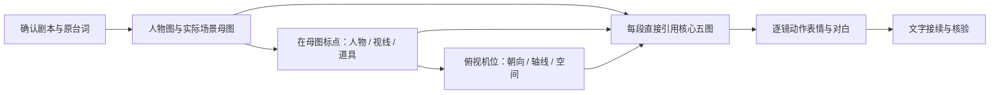

# blocking-to-video

**标点机位驱动视频**：从已确认剧本与实际人物/场景资产，制作标点图、俯视机位图，再编写能够独立复制的分段视频提示词。

适合真人对白、短喜剧和需要空间连续性的AI短片。它提供制作方法和检查工具，不自带生图/视频模型、账号或额度。

## 核心做法

两人场景使用**核心五图**：两张人物身份图、一张纯场景母图、一张实际母图标点图、一张俯视机位图。每段直接引用五图，每镜写明标点与机位的对应关系。



控制图不是装饰或仅供人看的附图。模型读取其空间含义，同时按提示词避免把箭头、字母和相机图标生成进影片。正反打效果图可作补充，不能替换控制图。

## 使用

将本目录放入你的Codex技能目录，目录名保持`blocking-to-video`。技能根目录由你的Codex安装配置决定；本仓库不要求固定操作系统或盘符。重新打开会话或按客户端方式刷新技能后，调用：

```text
使用 $blocking-to-video，读取我的已确认剧本和实际资产。
按核心五图直接引用，生成详细分段视频提示词。
每镜对应标点与俯视机位，保留原对白，用文字接续上下段。
```

只有剧本时，可先完成资产需求与场景设计；有现成资产时从实际标点继续；已有前段视频时检查末尾状态后接续，不重新开始制作。

## 文件入口

- [SKILL.md](SKILL.md)：技能主指令。
- [空间资产](references/spatial-assets.md)：母图、标点、机位。
- [视频提示词](references/video-prompts.md)：逐镜表演与文字接续。
- [分段模板](templates/segment-prompt.md)：可填写的提示词结构。
- [虚构示例](examples/two-person-prompt.md)：五图与逐镜引用示范，不含图片。
- [核验说明](references/validation.md)、[JSON格式](references/plan-format.md)：检查边界与数据约定。

## 本地检查

Python 3.9+，仅用标准库，不联网、不读取账号配置、不调用生成服务：

```bash
python scripts/validate_plan.py examples/two-person-plan.json
python scripts/validate_plan.py path/to/your-plan.json --check-files
```

示例JSON里的媒体未随仓库提供，不要对这个示例使用`--check-files`期望通过。真实项目使用该参数核查素材文件存在。

检查器能发现缺少核心图、台词遗漏/重复/变更、说话人错误、时间间隙/重叠以及缺少点位/机位。它不能判断图片真实位置、身份一致性、口型、动作可达性或成片好不好笑。

## 适用边界

- 单人/多人按参与角色调整身份图数量，保留场景、标点、机位三类控制参考。
- 画幅、时长、字幕、音色、音乐和夸张程度由当前项目决定。
- 平台须能接受当前参考数量；具体限制应当次核实，不能默默舍弃控制图。
- 默认用文字状态接续，不自动改用首尾帧模式；用户明确选择其他流程时遵从。
- 这里没有真实人物素材、比赛事实、私人项目记录或第三方书籍摘录。示例是自创说明，不代表已生成或已验收视频。

## 许可

[MIT](LICENSE)适用于本仓库的指令、文档和代码。使用者自行提供的照片、音频和视频不因此获得授权，也不自动受本仓库许可覆盖。
