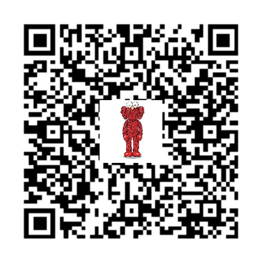

# 赞助与联系作者

这个Skill以MIT许可开放使用。你可以免费使用指令、模板和检查脚本；如果它帮你省下了制作时间，欢迎自愿扫码支持后续维护。

## 自愿赞助

金额随意。赞助用于支持项目，不是购买服务，也不附带指定功能、回复时限或更新交付承诺。

| 微信赞助 | 支付宝赞助 |
|---|---|
|  |  |
| [打开微信码原图](assets/support/wechat-qr.png) | [打开支付宝码原图](assets/support/alipay-qr.png) |

电脑端可用手机扫码；手机端可保存对应图片，再在微信或支付宝中使用扫一扫识别。二维码由作者提供；付款前请在支付应用中核对收款人。

这是作者的直接收款入口，GitHub不会按下载量或使用次数向作者分成。本项目也没有自动到账通知、订单开通或付费权限解锁系统。

## 联系作者／定制咨询

**微信：`LZRRR_0201`**

添加时请备注“GitHub 视频Skill”，并说明剧本类型、当前素材、生成平台和具体需求。可沟通：

- 场景标点图与俯视机位图设计。
- 现有剧本的详细分镜、分段视频提示词与文字接续。
- 针对实际生成结果的连续性问题排查和局部修订。
- **道具定位与跨镜一致性改进：可联系作者评估，作为后续更新方向；目前尚未完成该专项功能的实测，不承诺自动更新效果。**

定制服务的范围、可行性、交付时间和费用均需双方先沟通确认，再付款。自愿赞助与付费定制分开处理。

一般使用问题或缺陷也可以[提交Issue](https://github.com/cgzs-li/blocking-to-video/issues)。不要在公开Issue中发送付款截图、私密剧本、联系方式或账号凭证。

## 二维码使用说明

这里的二维码仅用于向本项目作者付款，使用方式沿用作者提供的原图。二维码及其内嵌图像不属于Skill通用素材；它们的展示不授予第三方更换收款人、冒用作者身份或将图像用于其他目的的权利。
